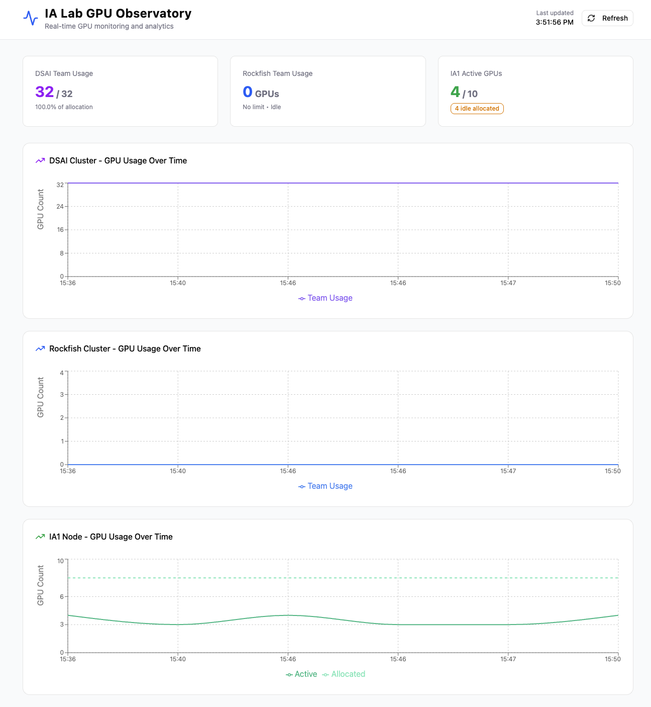
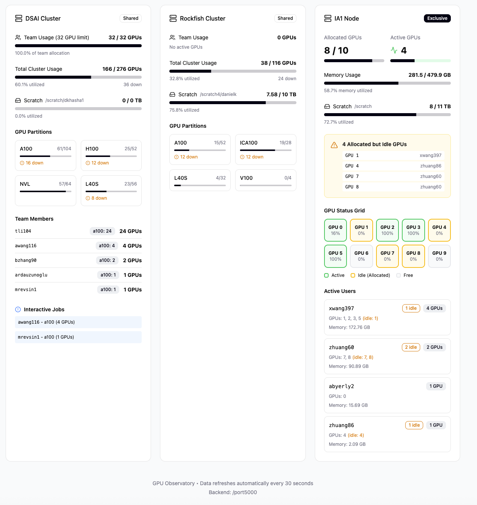

# GPU Stats Dashboard

Real-time GPU monitoring for Skipjack, DSAI, and IA1 servers. A FastAPI backend runs the collector scripts via SSH and exposes a REST API; a React/Vite frontend displays the data.




## Skipjack detailed monitor

Open **Skipjack details** for configurable account groups, quotas, fair share,
user perspectives, capacity, queue wait statistics, and persistent history.
See [setup, configuration, API, and tests](docs/skipjack-monitor.md).

## Requirements

- Python 3.9+
- Node.js 22 or 24 recommended for development
- SSH access configured for `skipjack`, `dsai`, and `ia1` hosts (the detailed monitor can also read local Slurm)

## Setup

### Backend

```bash
# Install Python dependencies (using uv)
uv sync

# Or with pip
pip install fastapi uvicorn aiofiles 'pydantic>=2,<3'
```

### Frontend

```bash
cd frontend
corepack pnpm install --frozen-lockfile
```

## Running

### Production (single command)

```bash
./run.sh
```

Builds the frontend (skipped if `frontend/dist/` already exists) and serves on port **5000**, with the frontend built for the existing `/port5000/` reverse proxy. For a direct localhost server, see the [monitor setup instructions](docs/skipjack-monitor.md#running). Pass `--rebuild` to force a fresh frontend build.

### Development (hot reload)

Open two terminals.

**Terminal 1 — backend** (port 8000):
```bash
uv run uvicorn app:app --reload --port 8000
```

**Terminal 2 — frontend** (port 5173):
```bash
cd frontend
corepack pnpm dev
```

Open http://localhost:5173/port5000/ in your browser.

## API Endpoints

| Method | Path | Description |
|--------|------|-------------|
| `GET` | `/stats` | All servers combined |
| `GET` | `/stats/skipjack` | Skipjack overview stats |
| `GET` | `/stats/skipjack/monitor` | Detailed Skipjack monitor |
| `GET` | `/stats/history` | Overview history |
| `GET` | `/stats/dsai` | DSAI stats |
| `GET` | `/stats/ia1` | IA1 stats |
| `POST` | `/stats/refresh` | Force-refresh all servers |
| `POST` | `/stats/{server}/refresh` | Force-refresh one server |

Overview stats are cached for 30 minutes. The backend refreshes all overview servers on startup and every 30 minutes in the background. The detailed monitor collects independently every five minutes by default.

## Project Structure

```
gpu-stats-ia1-lab/
  app.py                  # FastAPI backend
  pyproject.toml          # Python dependencies
  danielgpus_dsai.py      # DSAI collector script
  danielgpus_ia1.py       # IA1 collector script
  frontend/               # React/Vite frontend
    src/app/App.tsx
    src/app/components/
    src/app/types/
```
