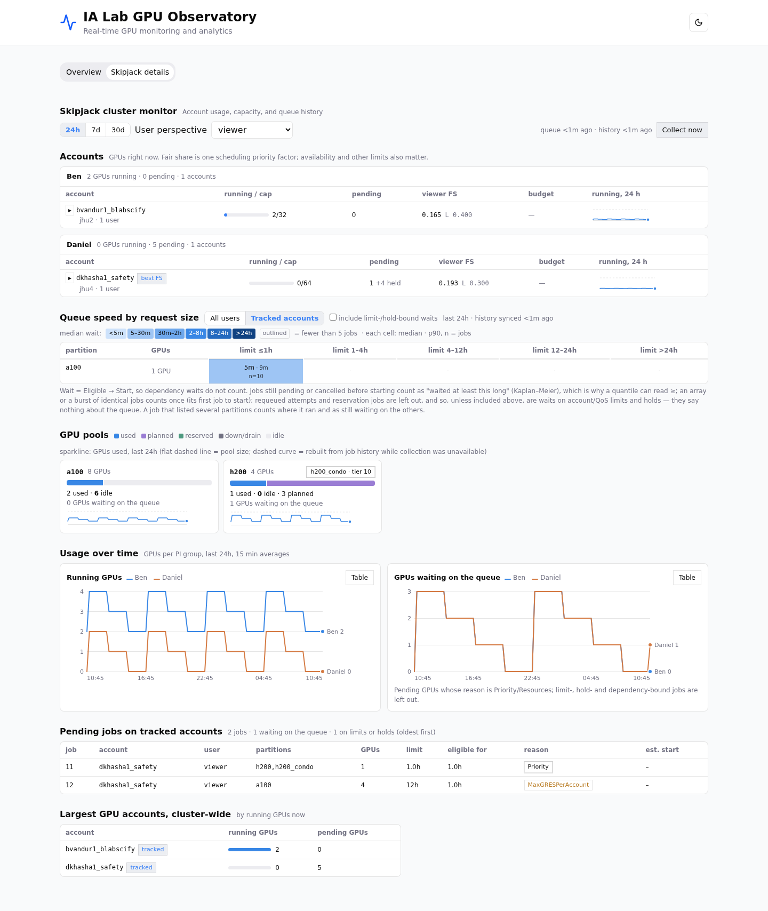

# Skipjack detailed monitor

The **Skipjack details** tab adds account quotas, fair share, usage budgets,
user usage, physical GPU pool capacity, queue wait statistics, pending jobs,
and persistent trends. The original Overview and its `/stats` endpoints retain
their existing collectors and response formats.

The monitor was adapted from the standalone monitor in
[sheepy928/jay2](https://github.com/sheepy928/jay2), originally developed in rcb.
It has no dependency on jay2, its agent runtime, authentication, or job submission.

Screenshots below use synthetic data from the offline preview.



[Dark mode](images/skipjack-monitor-dark.png) · [Mobile](images/skipjack-monitor-mobile.png)

## Running

Use Python 3.11 and Node 22/24 for development; the backend also supports Python
3.9. From the repository root:

```bash
uv sync
cd frontend
corepack pnpm install --frozen-lockfile
cd ..
```

Start the backend with `uv run uvicorn app:app --reload --port 8000` and the
frontend with `cd frontend && corepack pnpm dev`. Open
`http://localhost:5173/port5000/`.

For a direct production server without the existing path-stripping proxy:

```bash
cd frontend
VITE_BASE_PATH=/ corepack pnpm build
cd ..
uv run uvicorn app:app --host 127.0.0.1 --port 5000
```

The default frontend base remains `/port5000/`. For that deployment, the reverse
proxy must strip `/port5000` from both asset and API requests before forwarding
them to the backend. A base-path change requires rebuilding the frontend.

## Configuration

Settings are environment variables. `.env.example` documents them; neither
uvicorn nor the monitor implicitly loads an `.env` file. To use a local copy:

```bash
cp .env.example .env
# Edit .env, then export it in your shell:
set -a
. ./.env
set +a
```

All backend names below have the prefix `OBSERVATORY_MONITOR_`.

| Name | Default | Meaning |
|---|---|---|
| `ENABLED` | `true` | Set `false` and restart to stop this collector. |
| `TRANSPORT` | `auto` | `local` if all six Slurm tools exist; otherwise `ssh`. Can be set explicitly. |
| `SSH_HOST` | `skipjack` | SSH config alias or `user@host`. Uses existing keys/config and host-key verification, with noninteractive authentication. |
| `SLURM_BIN_DIR` | `/opt/mprov/cloack/slurm/current/bin` | Prepended to the local or remote PATH. Empty uses PATH unchanged. |
| `DB` | `<repo>/data/skipjack-monitor.sqlite3` | Private SQLite history. Explicit relative paths resolve from the working directory. |
| `GROUPS` | `bvandur1:Ben,dkhasha1:Daniel` | Account prefix/display-label pairs. Matches the prefix and underscore-prefixed descendants with user associations. |
| `PARTITIONS` | empty | Discover GPU partitions, including hidden lanes; optionally restrict to a comma-separated list. |
| `POLL_SECONDS` | `300` | Queue/nodes/shares interval, minimum 60 seconds. |
| `BACKFILL_DAYS` | `14` | Initial history, 0–90 days. Set 0 to disable initial backfill. |
| `COMMAND_TIMEOUT` | `60` | Deadline for each Slurm command, 1–300 seconds. |

SSH mode needs `python3` and the Slurm tools on the remote host. It sends a
small Python command wrapper over stdin and installs nothing remotely. Slurm
reads use argv arrays, discard inherited job settings, request epoch timestamps,
and have both client and remote timeouts. Auto mode selects the transport from
tool availability; it does not silently switch hosts after a failed read.

Run one backend worker per monitor database. An exclusive database lock prevents
multiple collectors from writing the same history. A second worker reports the
lock error in its status. Database and sidecar files have owner-only permissions.
Keep the database on storage that supports SQLite locking.

Collection is independent of browser visits. Accounting refreshes every ten
minutes, metadata hourly, and initial backfill uses paced one-day windows with
persisted successful-write checkpoints. Daily rescans and retention preserve
90 days of jobs and 60 days of samples. The overview still samples at its original
30-minute interval, so its timestamp and values can differ from the detailed tab.

## Reading the dashboard

The initial view shows account totals. **User perspective** selects a user from
cached associations in the tracked groups. It changes membership, user caps,
and the user's FairShare factor without changing collection, global totals, or
another browser's selection. The selector is a view filter, not authentication.

Account `LevelFS` and user `FairShare` describe different levels of Slurm's fair
share tree. The "best FS" badge compares member accounts with no recorded budget
and account headroom. It is not a start-time prediction or submission check.

Budgets show recorded billing-minutes or GPU-hours, including committed running
usage. No monetary conversion is assumed. QoS determines enforcement. Missing
readings remain unknown. Collection errors preserve previous successful data;
freshness/error notices identify that condition.

Shared physical nodes count once per pool, including condo aliases. Queue waits
start at eligibility. Arrays and short submission bursts contribute one
observation; pending and cancelled jobs are censored observations. Requeued
attempts and reservations are excluded. Limits/holds are included by default in
the dashboard; uncheck the filter to exclude them. These statistics intentionally differ from the original overview's
submission-to-start averages over individual started jobs.

History views cover 24 hours, 7 days, and 30 days. Missing samples remain gaps;
account trends reconstructed from accounting are marked estimated/dashed and
never replace observed samples. Reconstructed pool states borrow the nearest observed capacity snapshot;
historical availability cannot be recovered from accounting alone.

### Scheduler start estimates

The separate **Scheduler start estimates** table compares 18 concrete requests:
1, 4, and 8 GPUs, each with a 1, 4, 12, 24, 48, or 72-hour limit. Choose an account
and partition, then select **Probe now**. Requests use one node, one task, the
account's default QoS, and initially 8 CPUs and 64 GiB per GPU. The CPU and memory
selectors change those assumptions without sending tests. Only **Probe now** (or
an explicit API POST) requests tests; there are no automatic probe timers.
Every row shows the exact resources, estimate,
wait at probe time, timestamp, and expandable Slurm output. Rejected requests and
missing estimates have no wait value. Site CLI warnings remain visible in the output.

This uses [`sbatch --test-only`](https://slurm.schedmd.com/sbatch.html#OPT_test-only):
no job is submitted. It is the scheduler's current estimate, not an observed or
guaranteed start time. The probes run as the local server user or SSH login user,
which is shown above the table. **User perspective** does not impersonate that
user. Only underscore-suffixed tracked subaccounts with a cached association for
the probe identity can be selected; parent accounts are excluded. The default QoS,
fairshare, resource sizes, and queue state all matter.

`sbatch` is optional; missing test-mode support leaves the other monitor panels
available. Local and SSH execution both construct fixed argument lists and always
include `--test-only`; arbitrary scripts, Slurm options, and user impersonation
are not accepted. Environment-provided Slurm submission options are removed.

Each new batch checks half the table: 1/12/48-hour limits first, then 4/24/72-hour
limits, alternating independently for each account/partition/CPU/memory selection.
The other half's results and original timestamps are retained. Unchecked rows show
**Not probed yet**; results at least 15 minutes old are marked stale. The next
batch's limits and remaining cache interval are shown above the table.

Results and the next batch are shared across browsers and persisted in SQLite.
For the same settings, a POST within 15 minutes of the last batch reuses cached
results without advancing the batch. The visible details tab reads this cache
every minute; these GETs never invoke Slurm. A new batch has nine sequential calls
spaced one second apart, with a maximum 20-second Slurm command
timeout per call. Only one batch runs at a time and at most one new batch starts
per minute. Concurrent identical requests join the same batch; the cache retains
the latest 32 selections. Closing a browser request does not cancel shared work.

## API

All paths below start with `/stats/skipjack/monitor`:

| Method/path | Parameters |
|---|---|
| `GET` | Optional `user`, from `availableUsers`; omitted means account totals. |
| `GET /queue-speed` | `window=24h\|7d\|30d`, `scope=all\|ours`, `limited=exclude\|include`. `ours` means configured tracked accounts. |
| `GET /series` | `metric=groups\|pools`, `window=24h\|7d\|30d`. |
| `POST /refresh` | Joins an in-flight collection; otherwise permits one manual refresh per minute. |
| `GET /start-estimates` | Reads cached estimates, available probe accounts/partitions, all `timeLimitsMinutes`, and `nextTimeLimitsMinutes`. Optional `account`, `partition`, `cpus_per_gpu` (1–32, default 8), `memory_gib_per_gpu` (1–256, default 64). Defaults select the first available account and partition. |
| `POST /start-estimates` | Same query parameters; returns cached results or runs the next nine test-only requests, preserving the other half. Batches for the same settings are at least 15 minutes apart, with a global one-minute batch throttle. |

Invalid queries return 422. Refresh returns 503 if unavailable and 429 with
`Retry-After: 60` when throttled. GETs read cached data and do not invoke Slurm.
Response fields use camelCase. The monitor-specific OpenAPI snapshot and generated
TypeScript declarations are checked in; regenerate them with
`cd frontend && corepack pnpm generate:api` after model changes.

## Validation and offline preview

```bash
uv run pytest -q
cd frontend
corepack pnpm test
corepack pnpm typecheck
corepack pnpm build
cd ..
uv run uvicorn scripts.preview_monitor:app --host 127.0.0.1 --port 8017
```

The preview uses synthetic data and starts no SSH or Slurm collectors. It serves
both `/` and `/port5000/` for the corresponding frontend build. Browser checks:

```bash
uv run --with playwright python scripts/browser_monitor.py
```

Install Chromium with `uv run --with playwright playwright install chromium`
if needed, or pass `--browser /path/to/chromium`. The browser check covers both
themes, desktop/mobile layouts, user selection, filters, refresh, persistence,
and access when the overview is unavailable. Screenshots go to ignored
`artifacts/screenshots/`.

Explicit, bounded live checks use a fresh temporary database and close it afterward:

```bash
uv run python scripts/check_monitor.py --live --transport local
uv run python scripts/check_monitor.py --live --transport local --history-days 1
uv run python scripts/check_monitor.py --live --transport ssh
```

These only read Slurm; they never submit or cancel jobs. Default tests use fake
commands and temporary databases, with collection disabled.
